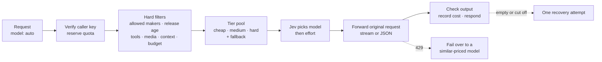

# Jev Router

[](https://github.com/rockbye-kunal/jev-router-rust/actions/workflows/ci.yml)
[](LICENSE)


A self-hosted, OpenRouter-compatible router that picks the **model and reasoning effort** for every request. Send `"model": "auto"` and the router builds a pool of cheap, medium and hard models, asks [Jev](https://openrouter.ai/docs/guides/routing/routers/jev-router) to choose once, forwards your original request, and checks the answer before returning it.

One Rust binary. No Node or Python runtime. Callers bring their own OpenRouter key and pay OpenRouter directly.

> This is an independent implementation of documented Jev Router behaviour. It is not OpenRouter's or TypeSafe's router source and does not reproduce their private rankings or scores. See [docs/compatibility.md](docs/compatibility.md).

## Why

Calling a fixed model is either expensive (a frontier model for every "hello") or unreliable (a small model for every hard task). Routing helps only if the routing step itself is cheap and predictable. This router:

- **Routes in one decision.** A capped, tiered pool of up to 22 models fits a single Jev comparison. Comparing the whole catalog took about 10 decisions per request.
- **Always offers a cheap, a medium and a hard option**, and tells Jev which tier each model is in.
- **Uses only the models you allow**, with a hard recency rule so retired releases never get picked.
- **Fails safe.** Rate limits fail over, empty answers are recovered once, and uncertain picks are double-checked.

Measured locally on the same short question, before and after tiered pools:

| | Whole catalog | Tiered pool |
|---|---:|---:|
| Jev decision calls | 10 | 2 |
| Routing time | 3.0 s | 1.7 s |
| Routing cost | $0.00197 | $0.00016 |

## How it works



1. **Authenticate.** The caller's OpenRouter key is verified (cached for 30 s). Its quota is reserved atomically in SQLite before any paid call.
2. **Filter.** Hard rules remove models that are not allowed, were released too long ago, or cannot handle this request's tools, images, JSON schema, context length or budget.
3. **Build the tier pool.** Each tier is a priority list of patterns. Every pattern resolves to its newest release. A hard pick must cost at least as much as the priciest medium pick. Empty tiers are backfilled by cost percentile. The fallback, repair and recovery models are always included.
4. **Decide.** Jev chooses the model, with an extra check against the fallback when confidence is low, then the reasoning effort for models that support several levels.
5. **Generate.** The full original request goes to the chosen model unchanged, in Chat Completions, Responses or Messages format, streamed or not.
6. **Check and record.** Empty or truncated answers get one bounded recovery. Simple money totals are verified exactly. Cost, model and effort are stored under the request ID.

## Features

- **Three wire protocols:** `/v1/chat/completions`, `/v1/responses` and `/v1/messages`, with SSE streaming, tools and structured output passed through.
- **Bring your own key:** per-key tenants, quotas and audit records. Keys are never stored or logged.
- **Tiered routing pool:** cheap, medium and hard tiers resolved from the live catalog, with stale patterns reported.
- **Hard model policy:** allow and deny lists, a maximum release age, and per-request exclusions.
- **Resilience:** rate-limit failover, per-key circuit breakers, output recovery, exact money-total checks, and session pinning for tool loops.
- **Operations:** JSON logs, `/healthz` and `/readyz`, graceful SIGTERM drain, crash recovery of in-flight reservations, and a non-root Docker image behind Caddy TLS.

## Quick start

Requires a current stable Rust toolchain.

```sh
git clone https://github.com/rockbye-kunal/jev-router-rust.git
cd jev-router-rust
cargo build --release --locked

cp .env.example .env            # then put OPENROUTER_API_KEY=... in .env
./target/release/jev-router --config config.local.json serve
```

In another terminal:

```sh
curl -s http://127.0.0.1:8788/v1/chat/completions \
  -H 'Content-Type: application/json' \
  -H 'X-OpenRouter-Metadata: enabled' \
  -d '{"model":"auto","messages":[{"role":"user","content":"Explain a mutex versus a semaphore in two lines."}],"max_tokens":1024}'
```

On loopback the server uses the key from `.env`. A public bind always requires each caller's own key. With `X-OpenRouter-Metadata: enabled`, the response includes the candidates, their tiers, the chosen model and effort, Jev cost and timings.

Prebuilt binaries for Linux x86_64 and macOS arm64 are attached to each [release](https://github.com/rockbye-kunal/jev-router-rust/releases).

## Configuration

Two ready-made configs ship with the repo: `config.local.json` (loopback) and `config.production.json` (public bind for Docker). Every field is optional and falls back to a built-in default. Unknown fields are rejected.

| Field | Default (shipped) | What it does |
|---|---|---|
| `pool_tiers.cheap / medium / hard` | see config files | Priority-ordered model patterns per tier. Empty on all three tiers means the whole catalog is compared. |
| `pool_per_tier` | `6` | Maximum models per tier. Extra patterns act as spares. |
| `hard_allowed_models` | OpenAI, Anthropic, Gemini, xAI, DeepSeek, Qwen | Only these patterns can ever be used. |
| `hard_excluded_models` | GPT-OSS, Qwen 2.x, older DeepSeek | Never used, even if allowed. |
| `max_model_age_days` | `365` | Models released longer ago are never used. `0` turns this off. |
| `fallback_model` | `anthropic/claude-sonnet-5.5` | Conservative pick when Jev is uncertain. |
| `repair_model` / `output_recovery_model` | `google/gemini-3.8-flash` / `openai/gpt-5.4` | Used for answer repair and empty-output recovery. |
| `daily_estimated_budget_usd` | `10` | Per-key daily estimated spend. |
| `max_request_estimated_usd` | `1` | Per-request estimate cap, including routing and repair. |
| `requests_per_minute` / `tenant_concurrent` | `60` / `4` | Per-key rate and concurrency. |
| `request_timeout_secs` | `240` | Total deadline for paid work, including streams. |
| `verify_text_answers` / `model_answer_review` | `true` / `false` | Exact checks on by default; model-based review off by default. |

Patterns are case-sensitive globs (`*`, `?`, `[0-9]`) or exact IDs. Check what they resolve to, without paid calls:

```sh
./target/release/jev-router --config config.local.json pool
```

### Command line

| Command | Purpose |
|---|---|
| `serve` | Run the HTTP server |
| `pool` | Show the models each tier resolves to and any stale patterns |
| `catalog` | Refresh the cached OpenRouter model catalog |
| `check-config` / `doctor` | Validate configuration and report status (never prints keys) |
| `health` | Readiness probe used by the Docker healthcheck |
| `smoke` / `acceptance` | Live end-to-end checks against a running router (billed) |

Use `--config <file>` for a config and `--env-file <file>` for an alternative `.env`.

## API

| Endpoint | Purpose |
|---|---|
| `POST /v1/chat/completions` | Chat Completions, including tools and SSE |
| `POST /v1/responses` | Responses API format |
| `POST /v1/messages` | Messages API format |
| `POST /v1/route` | Preview the routing decision without generating (Jev is billed) |
| `GET /v1/models` | Router identity and catalog summary |
| `GET /v1/usage` | The caller key's quota counters |
| `GET /v1/requests/{id}` | The caller key's routing and billing record |
| `GET /healthz`, `GET /readyz` | Liveness and catalog readiness |

The model can be `auto`, `jev-router` or `typesafe/jev-router`. Optional routing controls go in a plugin entry:

```json
"plugins": [{"id": "jev-router", "cost_tier": "medium", "allowed_models": ["anthropic/*"], "excluded_models": ["openai/*"]}]
```

`cost_tier` (`low`, `medium`, `high`) is a preference, not a price cap. Include lists are soft and exclusions are hard. Send `session_id` (or `X-Session-Id`) to keep tool loops and follow-up turns on the same model. Every response carries `x-request-id`, `x-jev-model`, `x-jev-effort` and `x-jev-reason` headers.

## Deployment

A single-node Docker deployment behind Caddy TLS is included:

```sh
export DOMAIN=router.example.com
docker compose up --build -d
```

The container runs as a non-root user on a read-only filesystem, logs JSON with rotation, and drains in-flight requests on stop. SQLite keeps it to one node per database. See [docs/deployment.md](docs/deployment.md) for the checklist, limits and operations.

## Testing

```sh
scripts/local-integration.sh          # fmt, clippy, all tests, release build, process e2e (no paid calls)
scripts/local-integration.sh --live   # plus one real billed request through a fresh server
```

The test suite runs real HTTP against local provider fixtures: routing, tiers, protocols, streaming, failover, recovery, quotas, tenant isolation, crash recovery and shutdown. CI runs the same checks plus `cargo audit` and a container smoke test. Recorded live results are in [docs/verification](docs/verification/VERIFICATION.md).

## Limitations

- Single node only (SQLite with an exclusive lock). Horizontal scaling needs a shared store.
- Local budgets are conservative estimates, not invoices. Set hard spending limits on your OpenRouter keys too.
- Routing quality depends on Jev and on your tier lists. Evaluate representative tasks against a fixed-model baseline before a wide rollout.
- Answer checks are exact only for simple money totals. Other answers are not verified for correctness.
- For very short, cheap questions the routing step can cost more than the answer.

## Project layout

```
src/        server, routing engine, tier pool policy, catalog, store, streaming, validation
tests/      HTTP system tests and a release-binary process test
docs/       deployment, compatibility and verification records
scripts/    local integration check
```

## Contributing

Issues and pull requests are welcome. See [CONTRIBUTING.md](CONTRIBUTING.md). Report security problems privately as described in [SECURITY.md](SECURITY.md). Changes are listed in [CHANGELOG.md](CHANGELOG.md).

## License

[MIT](LICENSE)
